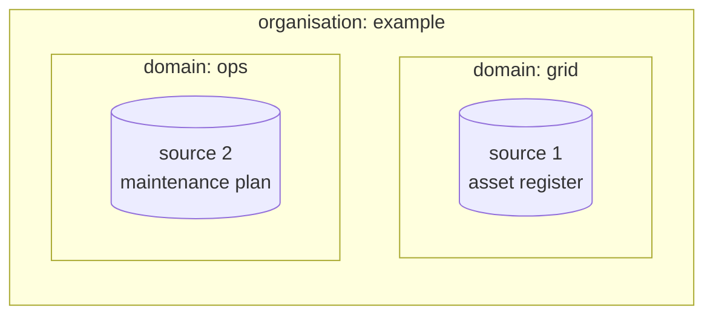
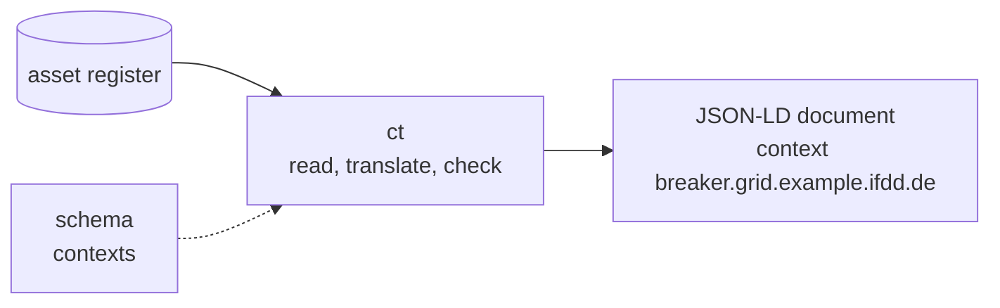
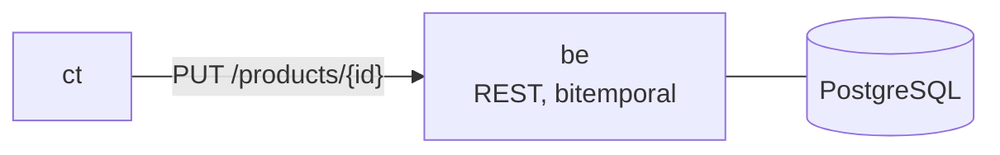
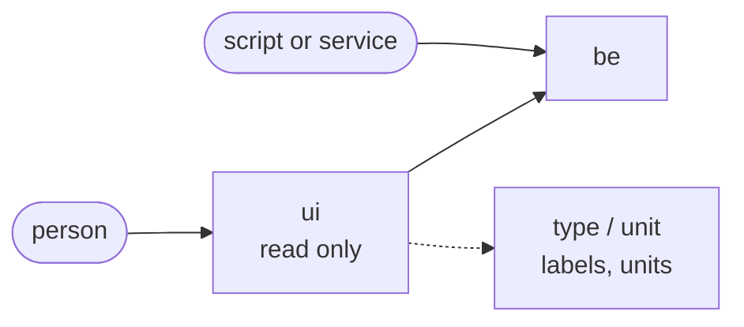
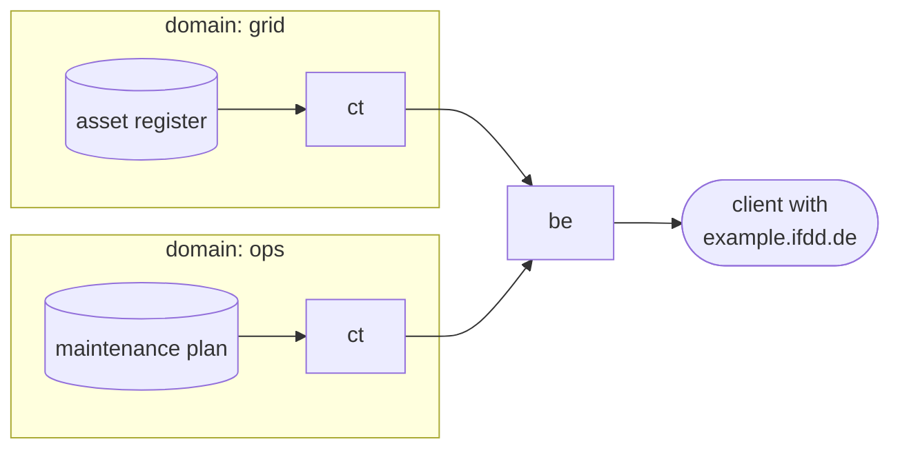
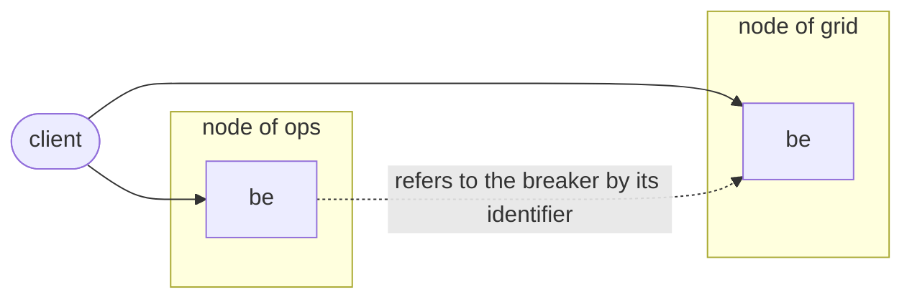

# 00 — A short walk through IFDD

This page builds the IFDD picture step by step, from one data source to several
domains that share meaning but not storage. It is adapted from the introduction of
[d4](https://github.com/smart-energy-di/d4/blob/main/docs/intro.md), the template
generation before IFDD (see [History](../../HISTORY_ifdd.md)). The story is the same;
the names and the building blocks are those of IFDD today.

Everything below is fictional. The organisation is called *example*, and the two
domain contexts are the example contexts of the [`schema`](https://github.com/ifdd-de/schema)
template: `breaker.grid.example.ifdd.de` and `maintenance.ops.example.ifdd.de`.
Parts that are not built yet are marked **planned**.

## A very first insight

An organisation, *example*, runs an electricity grid. Two departments keep data about
the same circuit breakers:

- the **grid** department keeps the asset register (serial number, manufacturer,
  rated voltage and current),
- the **ops** department keeps the maintenance plan (interval, last and next
  inspection, condition).

> **Domain** — a business area that owns its data and stays responsible for it. In
> d4 this was the *company*, a "context of same ownership".

Each source stays where it is and remains the single point of truth for its values.

## A shared vocabulary first

Before data can be combined it needs shared meaning. IFDD publishes the vocabulary
as JSON-LD contexts from their own services:

- **`schema`** — the contexts: `base`, the generic aspect contexts (`product`,
  `function`, `location`, `organisation`) and the domain contexts such as
  `breaker.grid.example.ifdd.de`,
- **`type`** — one vocabulary per namespace: labels and help texts (English and
  German), order of the fields, which context a reference points to,
- **`unit`** — units and quantity kinds, each linked to its QUDT counterpart.

The name of a domain context is written like a DNS name and read from right to left:
`breaker.grid.example.ifdd.de` belongs to `grid`, which belongs to `example`. The
name does not have to resolve in DNS; it only has to be unique and readable.

## From the source to JSON-LD

A source speaks its own format. Something has to translate it into documents that
use the shared vocabulary. In d4 this was the *adapter*; in IFDD it is
[`ct`](https://github.com/ifdd-de/ct) (core tools): a pipeline of small plugins that
reads a source, writes JSON-LD and checks it against the published contexts.
Workflows and notebooks that read sources can also run in
[`wf`](https://github.com/ifdd-de/wf).

`ct` checks today that a document uses only terms its context defines. Checks of
types and cardinalities are **planned**.

## Keeping what was sent

The converted documents need a place. In d4 this was a *cache* with volatile
storage. In IFDD it is [`be`](https://github.com/ifdd-de/be), built on
[`be-core`](https://github.com/ifdd-de/be-core): a REST service that keeps every
version with two time axes, when a value is valid and when the service knew it. The
source still owns the values; `be` records when it last received and confirmed them
(`c_cacheCreated`, `c_cacheUpdated`).

One object is stored as one document per context. The breaker `Q1` has

- a `product` document (generic: name, type, where it is installed),
- a `breaker.grid.example.ifdd.de` document from the asset register,
- a `maintenance.ops.example.ifdd.de` document from the maintenance plan.

Every context carries its own `objName`, `objType`, `objScope`, `origin` and
`publisher`. The asset register may call the breaker "Q1", the maintenance plan
"Q1 (bay 3)", and each says where its values came from.

## No fun without users

Stored data is only useful if someone can read it. People use
[`ui`](https://github.com/ifdd-de/ui), a read-only web front end; scripts and other
services use the REST interface of `be` directly. Both sign in through
[`keycloak`](https://github.com/ifdd-de/keycloak) (OpenID Connect).

The `ui` builds one tab per context of an object. Labels, help texts and the order
of the fields come from the vocabulary in `type`, units from `unit`; nothing is
written by hand per context. Editing data is the job of a separate editor, which is
**planned**; the `ui` stays read only.

## Who may see what

In d4 the *scope* was a "context of same permission", and each scope ran its own
services. IFDD separates the two:

- **where it runs** — a *node*, one set of services inside a domain
  (see [02 — Namespace](02-namespace.md)),
- **who may see it** — the *context*.

The rules are short:

- `base` and the aspect contexts are readable for every client with the read role
  and writable with the write role.
- A **domain context** also needs a matching **context pattern**: a client role
  with a dot. A pattern matches the context name and every name below it, at label
  boundaries.

| Client pattern | `breaker.grid.example.ifdd.de` | `maintenance.ops.example.ifdd.de` |
| --- | --- | --- |
| `example.ifdd.de` | yes | yes |
| `grid.example.ifdd.de` | yes | no |
| none | no | no |

A client without a matching pattern simply does not see that part of the object;
lists leave it out and count only what is visible. Asking for a context directly
without the pattern gives `403`, not `404`: the existence of a context is not a
secret, its content is. People get patterns through groups (`ifdd_ctx_<pattern>`),
services through their client roles.

## Only one domain is boring

With both departments publishing, a client with the pattern `example.ifdd.de` sees
the breaker from both sides: its rated values from the asset register and its next
inspection from the maintenance plan. Neither department had to give up its data
or its system.

## Now take off a little

The ops department may also run a node of its own, with its own `be`. Then the
records live in two places. They still fit together because

- identifiers are permanent and independent of where a record is stored
  (`id.ifdd.de/<domain>/<uuid>`, see [02 — Namespace](02-namespace.md)),
- both sides use the same published vocabulary.

A `be` does not fetch records from another `be`. Combining them is the client's job:
it reads both and joins them by identifier. That is the point of
**a shared schema instead of a shared system**. In d4 the same question read "which
booking systems run, and where"; in IFDD a product refers to its location
(`containedIn`), and a client follows that reference across nodes.

## From d4 to IFDD

| d4 | IFDD |
| --- | --- |
| company — context of same ownership | domain |
| scope — context of same permission, and the unit of deployment | node (deployment) and domain context with a context pattern (permission) |
| data source | source, the single point of truth for its values |
| d4 adapter | `ct`, and workflows in `wf` |
| d4 cache, volatile storage | `be` / `be-core`, persistent and bitemporal |
| d4 UI | `ui`, read only |
| JSON-LD schemas inside the services | `schema`, `type` and `unit` as services of their own |
| manual enrichment of a source | separate editor (**planned**) |
| — | permanent identifiers, separate from location |
