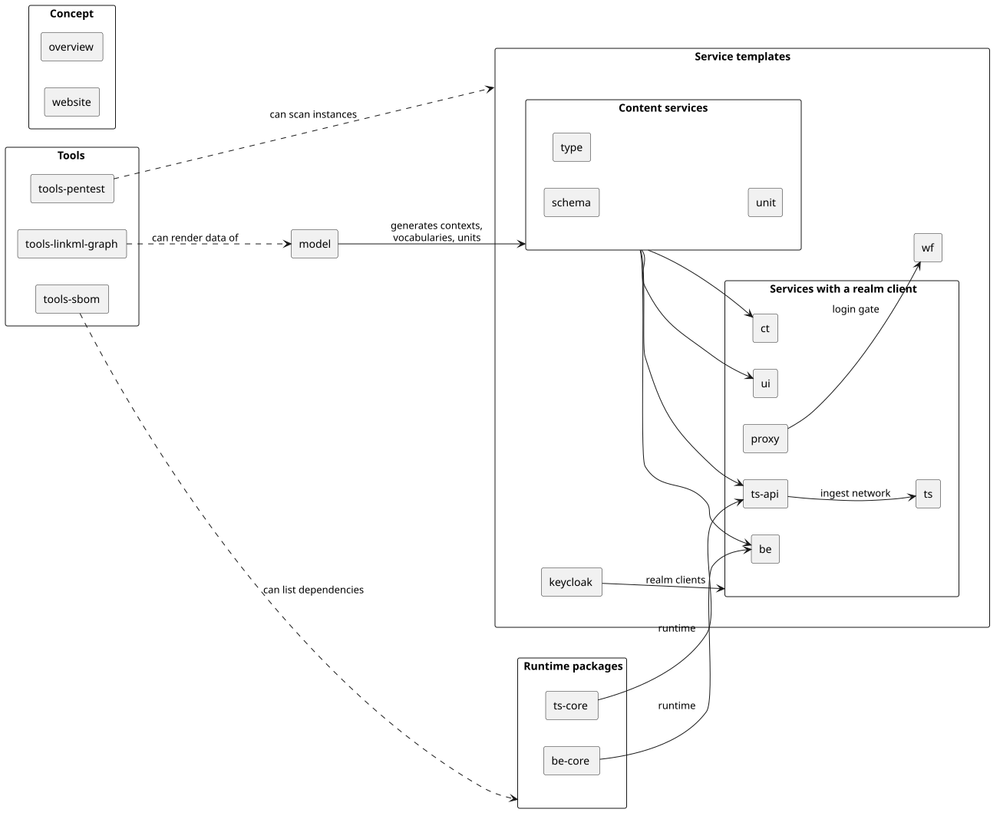

# 03 — Repositories: how they fit together

The `ifdd-de` organisation holds a concept repository, templates, runtime packages and
tools. This page shows how they relate, first as groups, then repository by repository.
The arrows show what one repository provides for another: code, templates and
content. Calls between running services are described in the documentation of each
service (`docs/` of the instances).

## Groups

- **Templates become instances.** Every service template, and the model template, is a
  cookiecutter template. An installation generates its own repositories from them with
  `cruft create` and takes later template changes in with `cruft update`. Running
  services are always instances, never the templates themselves.
- **Packages carry the runtime.** `be` and `ts-api` are thin templates around the
  Python packages `ifdd-be-core` and `ifdd-ts-core`, published on PyPI.
- **The model feeds the content services.** `model` generates the JSON-LD contexts,
  vocabularies and units from LinkML sources; `schema`, `type` and `unit` serve them.
- **Tools stand apart.** They work on instances or on sources, but no service needs them.

## Repository by repository

| Arrow | Meaning |
| --- | --- |
| `model` → content services | generates the contexts (`schema`), vocabularies (`type`) and units (`unit`) that an installation publishes into the content repositories of these services |
| content services → `be`, `ui`, `ct`, `ts-api` | they take the URLs of the content services as configuration: `be` checks documents against the contexts, `ct` checks generated records, `ui` shows labels and units, `ts-api` checks samples against the vocabularies |
| `keycloak` → services with a realm client | the realm generated by `keycloak` holds a client for `be` and `ui` (shared), `ct`, `ts` (Grafana), `ts-api` and `proxy` (oauth2-proxy) |
| `be-core` → `be`, `ts-core` → `ts-api` | runtime package of the service |
| `ts-api` → `ts` | `ts-api` writes into the VictoriaMetrics of `ts` through its ingest network |
| `proxy` → `wf` | `wf` has no login of its own; the login gate of `proxy` (oauth2-proxy) protects it |
| dashed arrows | can be used, not required: `tools-linkml-graph` renders data described by LinkML schemas, such as those of `model`, as documents and graphs, `tools-sbom` lists the dependencies of a Python or JavaScript project, `tools-pentest` scans the instances of an installation (own systems only) |

`proxy` is in front of every service with a web interface; that is a runtime relation
and not drawn. `overview` (this repository) and `website` (`ifdd.de`) describe all
repositories and have no arrows.

The diagrams are PlantUML sources in [`diagrams/`](diagrams/); see
[CONTRIBUTING](../../CONTRIBUTING.md) for how to render them.
